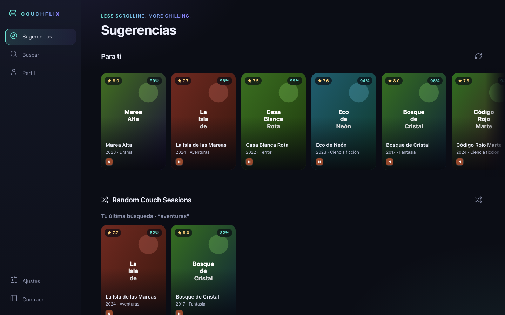
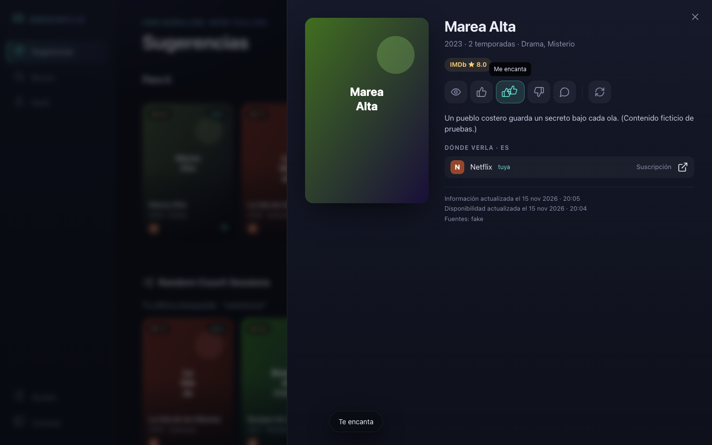
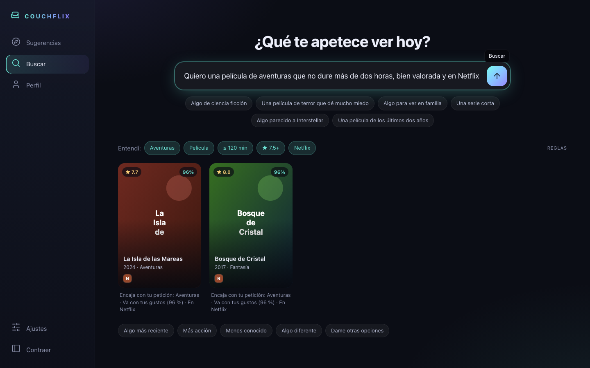

<p align="center"></p>

<h1 align="center">COUCHFLIX</h1>
<p align="center"><strong>Less scrolling. More chilling.</strong></p>

Intelligent entertainment discovery: an agent that knows your taste, your streaming platforms and your history, and always has something good ready. Runs locally with **a single command**.



> The interface and the built-in rules agent are in Spanish.

## Features

- **Sugerencias (Suggestions)**: a personalized carousel ("Para ti") and, kept separate, *Random Couch Sessions* (seasonal picks, hidden gems, outside your comfort zone, your last search).
- **Buscar (Search)**: ask the agent anything in natural language and refine with one tap ("more recent", "other options"…).
- **Perfil (Profile)**: a 6-dimension audiovisual radar that builds up from the centre, with top genres, evolution and an activity history.
- **Detail view** with icon actions: watched, like, love, dislike, comment and refresh; metadata and availability update dates are shown separately.
- Everything is stored in **SQLite**; switching sections never triggers new searches.
- Swappable catalog providers (`ICatalogProvider`) with normalization, de-duplication and per-attribute provenance.
- Skeletons that match the real cards exactly, subtle micro-interactions, collapsible sidebar, keyboard/touch support, `prefers-reduced-motion`.

| First-load placeholders | Carousel |
|---|---|
|  |  |

| Detail | Profile |
|---|---|
|  |  |

| Search | Agent results |
|---|---|
|  |  |

> Screenshots are generated with Playwright against a **fictional test catalog** (fixtures) so they can be produced offline and without API keys. In real use you get posters and data from TMDB.

## Requirements

- Python 3.11+ (`uv` is optional: if installed it is used to create the environment).
- A free [TMDB](https://www.themoviedb.org/settings/api) API key for real data.

## Getting started

```bash
cp .env.example .env     # then add your keys (or run `make env`)
./couchflix              # or: make run
```

The launcher checks Python, creates `.venv`, installs dependencies, creates/migrates the database and starts the server at <http://127.0.0.1:8765>.

Run `make` to list every helper command (`run`, `test`, `unit`, `e2e`, `screenshots`, `build`, `rebuild`, `clean`, `clean-db`, `reset`…).

### Standalone binary (optional)

```bash
make build      # produces dist/couchflix (PyInstaller); dist/ and build/ are git-ignored
```

Run it from a folder that contains your `.env`; the database is created in `./data`. The binary is built for the OS/architecture you build it on.

## Configuration

Through environment variables, a `.env` file in the working directory (see `.env.example`), or from the UI (settings icon at the bottom of the sidebar):

| Variable | Description |
|---|---|
| `TMDB_API_KEY` | TMDB key (v3) or token (v4). Without it the app still starts and asks you to configure a provider. |
| `COUCHFLIX_PROVIDERS` | Registered providers, `tmdb` by default. |
| `COUCHFLIX_DB` | SQLite path. Defaults to **`data/couchflix.db`**. |
| `COUCHFLIX_PORT` / `COUCHFLIX_HOST` | `8765` / `127.0.0.1`. |
| `COUCHFLIX_LLM`, `ANTHROPIC_API_KEY`, `OPENAI_API_KEY`, `OPENAI_BASE_URL` | Optional LLM agent (see [Agent](#agent)). |

Initial values: country **Spain**, platform **Netflix** (only until you configure your own), empty history, and a neutral profile with every dimension at **50**. If you turn off all platforms, Netflix is not assumed: you are told, and searches run without a subscription filter. Settings also let you change the country, platforms, the Random Couch Sessions refresh interval, active providers, credentials, the LLM, recalculate the profile and export your data.

### Profile learning

Each dimension starts at 50. **Love** and **like** push it up, **dislike** pulls it down (the strongest signal), watching without rating is neutral, and searches *you* type add a weak, capped nudge. Suggestions generated automatically by the app, and refinement buttons, never affect your profile or appear in your activity history. The profile can be recalculated from the stored history at any time.

## Providers

All providers implement `ICatalogProvider` (`search`, `get_details`, `get_availability`, `get_provider_name`, `is_available`). Recommendations only read the normalized catalog through `CatalogService`, never a provider directly.

- **TMDB** (active): metadata, posters, genres, TMDB rating and per-country availability. TMDB's availability data is provided by JustWatch, so that attribution must be shown.
- **JustWatch** (`justwatch.py`, **disabled**): research outcome → [its partner API requires a contract and a partner token](https://apis.justwatch.com/docs/api), its [terms](https://partners.justwatch.com/legal/termsofuse) restrict public/commercial use of the content and require branded links, and unofficial libraries have neither support nor permission. COUCHFLIX therefore **does not scrape it**. If you obtain partner access, implement the adapter's three methods and add `justwatch` to `COUCHFLIX_PROVIDERS`.
- **OMDb / others**: write a class implementing the interface and register it in `web/app.py:build_providers`. Per-attribute priority is configurable through `provider_priority`.
- `fake` / `fake_down`: **tests only**, never enabled by default and excluded from the binary.

The app keeps working from persisted data if a provider goes down.

Cache policy: metadata 30 days, availability 24 h (independent); the refresh icon in the detail view forces a query.

## Agent

By default a **rules engine** (Spanish) interprets the request (genre, duration, rating, platform, recency, "similar to…", surprise, etc.). The UI always shows whether the answer came from **Reglas** (rules) or **IA** (LLM). To use an LLM (it only interprets the request; if it fails, the rules engine takes over):

- Anthropic: `COUCHFLIX_LLM=anthropic` and `ANTHROPIC_API_KEY`.
- OpenAI-compatible (OpenAI, OpenRouter, Ollama…): `COUCHFLIX_LLM=openai`, `OPENAI_API_KEY`, and `OPENAI_BASE_URL` if you are not using api.openai.com. The model is chosen in Settings (default `gpt-4o-mini`).

## Tests

```bash
make test                             # unit + Playwright acceptance (no Internet needed)
./couchflix test tests/unit           # unit only
./couchflix test -m screenshots       # regenerate docs/screenshots
```

Acceptance tests start the real app with the fictional provider and a temporary database.

## Project layout

```
couchflix_app/
  domain/          entities, criteria, profile
  application/     use cases (Couchflix facade)
  services/        catalog, recommender, profile, agent
  infrastructure/  SQLite + migrations, repositories, providers
  web/             FastAPI + UI (HTML/CSS/JS, no build step)
tests/             unit/ and e2e/
```
